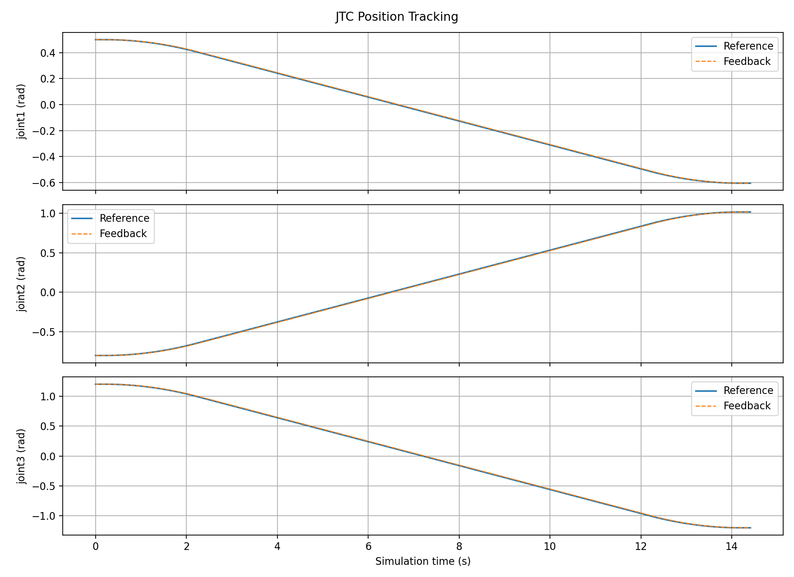
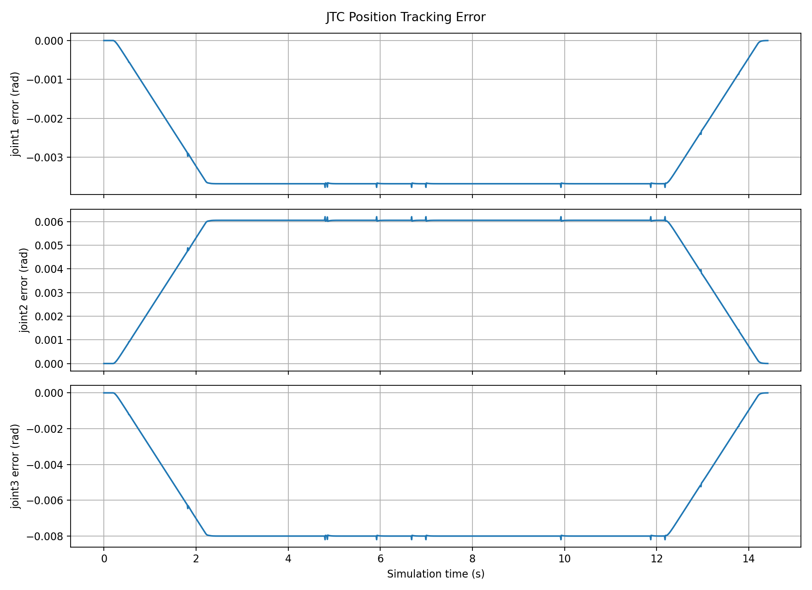

# MoveIt/JTC 实验记录

本目录在 Git 中保留三组 ROS 2 Jazzy / MCAP 关节轨迹控制器记录的元数据，以及已有的位置、误差曲线和一份分析文本。原始 MCAP 仅保留在本地原位置，不随日常提交上传。返回[首页](../README.md)；分析算法与输出规则见[脚本说明](../scripts/README.md#moveitjtc-录包分析)。

新克隆不含完整录包，只有 `metadata.yaml` 不能重新分析或回放；需先取得相应 MCAP 数据并与元数据放在同一目录。已有图片和分析文本可直接查看。新增实验数据默认仅本地保存，详见[数据管理规则](../README.md#实验数据管理)。下文统计沿用已有记录，本次管理调整未重新采集或生成曲线。

## 录包索引

下表使用目录名末尾的标识作为简称，链接指向完整路径。时长与数量来自元数据，并已通过只读遍历核对：

| 记录 | 录包时长 | 总消息数 | JTC 状态 | `/joint_states` | `/clock` |
| --- | --- | --- | --- | --- | --- |
| [speed020 · 152914](moveit_jtc_speed020_20261012_152914/metadata.yaml) | 20.35 s | 4,072 | 2,036 | 2,036 | 未录制 |
| [speed020 · 153411](moveit_jtc_speed020_20261012_153411/metadata.yaml) | 28.36 s | 5,674 | 2,837 | 2,837 | 未录制 |
| [gain020_speed020 · 155117](moveit_jtc_gain020_speed020_20261012_155117/metadata.yaml) | 29.69 s | 35,448 | 2,880 | 2,881 | 29,687 |

JTC 状态话题为 `/joint_trajectory_controller/controller_state`，类型为 `control_msgs/msg/JointTrajectoryControllerState`；另外两个话题分别使用 `sensor_msgs/msg/JointState`、`rosgraph_msgs/msg/Clock`。三组状态消息的关节顺序均为 `joint1, joint2, joint3`，有效状态的消息头时间严格递增，并包含非零参考速度样本。

录包时长不是分析运动窗口的时长。分析脚本使用控制器状态自身的消息头时间，因此前两组没有单独录制 `/clock` 不等于没有可用的仿真时间戳。

名称中的 `speed020`、`gain020` 是记录标识，不是参数快照。当前源码中的插件增益 `0.2`、MoveIt 默认缩放 `0.1`，均不能单独证明各次采集时实际使用的设置。元数据也没有记录每次规划动作的执行结果，不能只凭录包名称认定某种配置已通过验收。

## 只读查看

本地具备完整录包后，在工作空间根目录运行：

```bash
source /opt/ros/jazzy/setup.bash
ros2 bag info jtc_records/moveit_jtc_speed020_20261012_152914
ros2 bag info jtc_records/moveit_jtc_speed020_20261012_153411
ros2 bag info jtc_records/moveit_jtc_gain020_speed020_20261012_155117
```

这些命令不回放消息。若后续需要回放，应与正在运行的仿真隔离，避免重复发布关节状态、控制器状态或 `/clock`。

## 已保存结果

每组对应的 `_analysis/` 目录包含 `joint_positions.png` 和 `joint_errors.png`：

- [speed020 · 152914 曲线](moveit_jtc_speed020_20261012_152914_analysis/)
- [speed020 · 153411 曲线](moveit_jtc_speed020_20261012_153411_analysis/)
- [gain020_speed020 · 155117 曲线](moveit_jtc_gain020_speed020_20261012_155117_analysis/)

第三组另有[保存的分析文本](moveit_jtc_gain020_speed020_20261012_155117_analysis.txt)。该文本报告 2,880 条有效状态、1,442 条运动窗口样本、`14.410 s` 分析时长，以及三个关节约 `39.993 ms` 的等效跟踪滞后。这里引用的是已有分析文件；本次文档更新没有重新执行会覆盖图片的分析脚本。拟合滞后不等于单独测出的通信延迟。

### 第三组位置跟踪



### 第三组位置误差



重新运行分析时，会覆盖所选录包对应的这两张图片。完整使用方式见[分析脚本说明](../scripts/README.md#moveitjtc-录包分析)。
