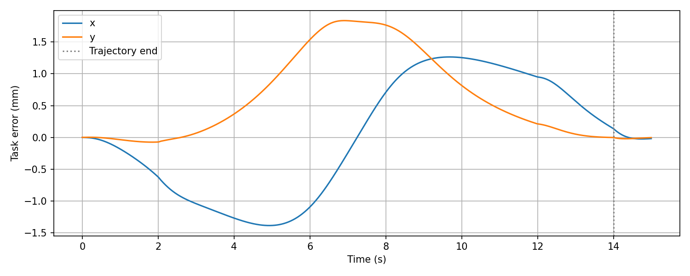

# MoveIt 轨迹与离线 OSC 数据

本目录保留一条 MoveIt 规划及其转换、插值和离线闭环结果。返回[首页](../README.md)；生成方法与覆盖行为见[轨迹工具](../src/three_link_arm_moveit_config/tools/README.md)。

下表中的 NPZ 和已有图片作为精选样例继续纳入 Git，不因原始录包停止上传而移除。本目录新生成的轨迹和分析输出默认仅本地保存；确认用于复现或展示后再选择具体文件提交，不按 NPZ 扩展名一刀切删除。已跟踪样例的后续修改仍会被 Git 发现，详见[数据管理规则](../README.md#实验数据管理)。

## 文件索引

共同前缀为 `moveit_trajectory_20261013_085205`，以下信息来自只读检查现有 NPZ：

| 文件 | 样本数 | 时间范围 | 内容 |
| --- | --- | --- | --- |
| [原始轨迹](moveit_trajectory_20261013_085205.npz) | 141 | `0–13.994473236 s` | MoveIt 的 `t/q/dq/ddq` 与关节名称 |
| [任务空间转换](moveit_trajectory_20261013_085205_osc.npz) | 141 | 同上 | 增加二维任务参考、`J_dot dq`、最小奇异值及坐标系 |
| [100 Hz 密集轨迹](moveit_trajectory_20261013_085205_osc_interp_100hz.npz) | 1,401 | 同上 | 五次 Hermite 插值后按 `10 ms` 采样，并保留精确终点 |
| [离线闭环记录](moveit_trajectory_20261013_085205_osc_interp_100hz_closed_loop/tracking.npz) | 1,500 | `0–14.990 s` | 包含运动及终点保持的控制采样数据，不是 Gazebo 录包 |

轨迹关节顺序为 `joint1, joint2, joint3`。起点约 `[0.500018, -0.800045, 1.200040] rad`，终点约 `[-0.616638, 1.004741, -1.198854] rad`。转换与密集文件的任务坐标系为 `arm_base`。

## NPZ 字段

| 字段 | 形状与单位 |
| --- | --- |
| `t` | `N`，轨迹时间，s |
| `q / dq / ddq` | `N × 3`，rad / rad·s⁻¹ / rad·s⁻² |
| `joint_names` | 三个关节名称 |
| `x / dx / ddx` | 转换后和密集文件中的 `N × 2` 任务参考，m / m·s⁻¹ / m·s⁻² |
| `jdot_dq` | 仅 `_osc.npz` 中保存，`N × 2` |
| `sigma_min` | 转换后和密集文件中的 `N` 个雅可比最小奇异值 |
| `task_frame` | 转换后和密集文件中的字符串 `arm_base` |

原始采集文件没有 `task_frame`，不能直接满足文件驱动 OSC 节点的输入要求。该节点读取关节轨迹并重新计算任务参考，不直接使用保存的 `x/dx/ddx`。具体启动及校验见[节点说明](../src/three_link_arm_kinematics/README.md#moveit-文件轨迹-osc)。

离线 `tracking.npz` 使用另一套字段：`time, q, q_d, e_q, x, x_d, e_x, tau, tau_raw, sigma_actual`。其中 `tau` 为限幅后指令，`tau_raw` 为限幅前需求；不要与参考文件的 `t`、`x` 含义混用。

## 已保存的离线曲线

完整结果位于[离线闭环目录](moveit_trajectory_20261013_085205_osc_interp_100hz_closed_loop/)，包含 `task_error.png`、`joint_error.png` 和 `torque.png`。以下为已有末端误差曲线：

该实验脚本使用标称模型、`10 ms` 控制周期、`1 ms` 积分及运动后约 `1 s` 保持；现有控制采样最后一帧为 `14.990 s`。本次只检查文件结构与有限数值，没有重跑仿真或覆盖图片。

真实 Gazebo 反馈记录的元数据和精选分析结果保存在 [`osc_records/`](../osc_records/README.md#moveit-文件轨迹录包)，完整原始 MCAP 仅本地保存。离线模型结果、录包数据和控制器参数属于不同层次；文件存在并不证明任意新轨迹都满足奇异性、力矩或跟踪边界。
