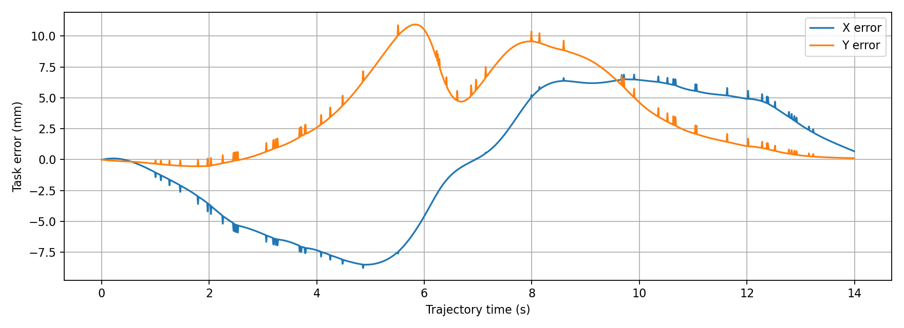
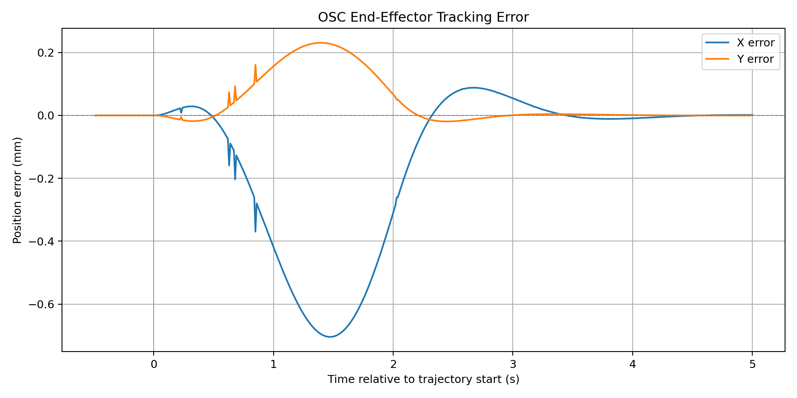
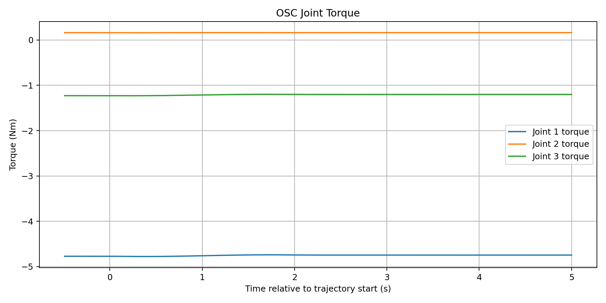
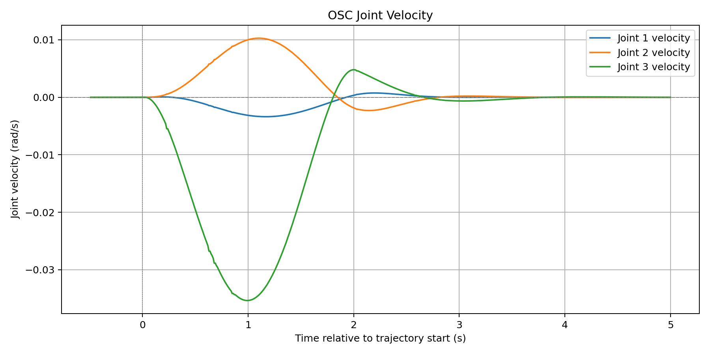
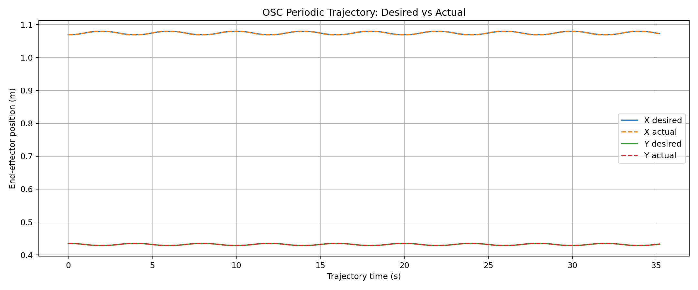
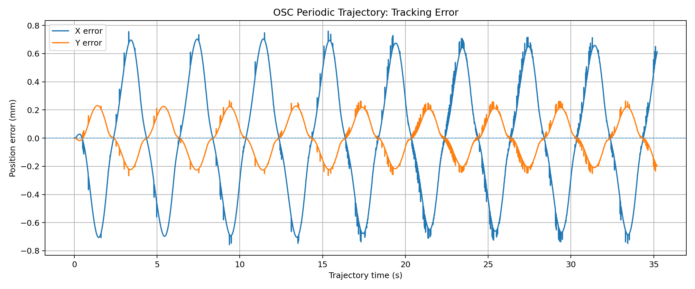
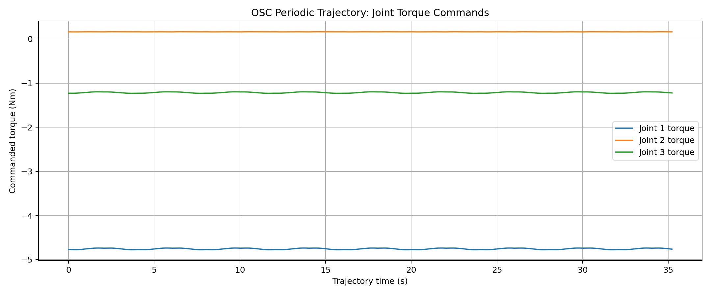
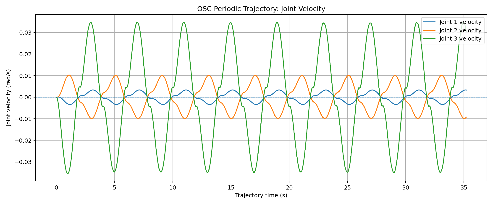

# OSC 实验记录

本目录在 Git 中保留七组 ROS 2 Jazzy / MCAP 实验的元数据和精选分析结果，包括基线/周期实验和三组 MoveIt 文件轨迹 OSC 实验。原始 MCAP 仅保留在本地原位置，不随日常提交上传。返回[首页](../README.md)；原有绘图见[辅助脚本](../scripts/README.md)，文件轨迹分析见[MoveIt 工具](../src/three_link_arm_moveit_config/tools/README.md)。

新克隆只含元数据和已保存结果，不含完整录包。下文的录包读取、分析和回放需要先取得同组 `metadata.yaml` 及所有 MCAP 分片；已有图片和 NPZ 可以直接查看。新增实验数据默认忽略，精选文件需另行确认后纳入 Git，详见[数据管理规则](../README.md#实验数据管理)。下文历史统计和曲线沿用已有记录，本次管理调整未重新采集或运行分析。

## 录包索引

时长和消息数量来自各自的 `metadata.yaml`：

| 录包 | 时长 | 总消息数 | `/joint_states` | `/osc_tracking` | `/effort_controller/commands` |
| --- | --- | --- | --- | --- | --- |
| [`baseline_01`](baseline_01/metadata.yaml) | 40.22 s | 11,639 | 4,023 | 3,808 | 3,808 |
| [`saturation_01`](saturation_01/metadata.yaml) | 51.24 s | 15,333 | 5,084 | 5,124 | 5,125 |
| [`periodic_01`](periodic_01/metadata.yaml) | 65.92 s | 19,423 | 6,593 | 6,415 | 6,415 |
| [`periodic_60s_01`](periodic_60s_01/metadata.yaml) | 150.11 s | 44,933 | 14,912 | 15,010 | 15,011 |

完整的本地录包每组包含 `metadata.yaml` 和一个同名前缀的 `_0.mcap` 文件；当前 Git 版本只跟踪前者。`/joint_states` 为 `sensor_msgs/msg/JointState`，另两个话题为 `std_msgs/msg/Float64MultiArray`。跟踪消息的[16 字段格式](../src/three_link_arm_kinematics/README.md#osc-接口)与关节空间 CSV 的 13 字段格式不同。

这些目录名用于区分记录，不是完整的工况说明。附带元数据没有保存控制增益、力矩上限或参数快照；不能仅凭 `saturation_01` 的名称推断当时具体的限幅值，也不能将当前 `osc_params.yaml` 当作录制参数证明。录包时长包含等待等阶段，不等于轨迹移动时长。

只读遍历当前文件时，`baseline_01` 中有 2,982 条跟踪消息满足轨迹时间 `t > 0`，而 `saturation_01` 中没有这样的记录。因此后者不能直接作为已启动轨迹的跟踪结果；当前绘图脚本若改读该录包，会因未检测到轨迹开始而报错。这一观察本身不能确定当时未启动轨迹的原因。

新增录包的启动后跟踪记录也已只读核对：`periodic_01` 有 3,522 条，轨迹时间约 `0.002–35.212 s`；`periodic_60s_01` 有 13,943 条，约 `0.009–139.429 s`。后者虽然名称含 `60s`，实际并非只有 60 秒。录包时间和消息中的轨迹时间是不同量，分析时应分别使用。

## MoveIt 文件轨迹录包

以下三组对应文件驱动的 `moveit_osc_effort_monitor`。简称用于缩短表格，链接指向完整目录；数量和时长已与实际 MCAP 只读遍历结果核对：

| 录包简称 | 时长 | 总消息数 | `/joint_states` | `/osc_tracking` | 力矩命令 | `/clock` |
| --- | --- | --- | --- | --- | --- | --- |
| [effort · 103450](moveit_osc_effort_20261013_103450/metadata.yaml) | 37.75 s | 11,327 | 3,775 | 3,776 | 3,776 | 未录制 |
| [cm200 · 110618](moveit_osc_cm200_20261013_110618/metadata.yaml) | 24.30 s | 33,221 | 4,860 | 2,392 | 2,392 | 23,577 |
| [cm100_repeat · 111108](moveit_osc_cm100_repeat_20261013_111108/metadata.yaml) | 26.28 s | 34,023 | 2,568 | 2,589 | 2,589 | 26,277 |

力矩命令话题为 `/effort_controller/commands`。前三类消息与上面的 OSC 格式相同，新增 `/clock` 为 `rosgraph_msgs/msg/Clock`。目录名里的 `cm100`、`cm200` 不是控制器管理器参数快照，不能只凭名称确认录制时的实际更新频率。

对应参考文件为仓库中约 `13.994473236 s` 的[密集 MoveIt 轨迹](../moveit_trajectory_records/README.md)。三组录包的最大累计轨迹时间分别为 `33.457 s`、`23.365 s`、`21.922 s`，均包含参考终点后的记录；这只是时间范围证据，不保证中间每个采样时刻都无缺口。

已有分析目录分别为：

- [effort 分析](moveit_osc_effort_20261013_103450_analysis/)
- [cm200 分析](moveit_osc_cm200_20261013_110618_analysis/)
- [cm100_repeat 分析](moveit_osc_cm100_repeat_20261013_111108_analysis/)

每组均含 `gazebo_tracking.npz`、`gazebo_task_error.png`、`gazebo_joint_error.png`、`gazebo_torque.png`。NPZ 保存 `t, xd, x, ex, qd, q, eq, dq, tau, sigma_min`；数据仅为运动阶段，而非完整录包。三组现有分析样本数依次为 1,399、1,399、1,400，时间范围分别为 `0.007–13.987 s`、`0.005–13.985 s`、`0.002–13.992 s`。

下图为 `cm100_repeat` 已保存的末端误差曲线，不是本次重新生成：



分析工具只使用启动后的运动区间计算指标，末端保持另行报告；其饱和附近计数使用固定 `9.999 N·m` 阈值。输入、输出与覆盖行为见[工具说明](../src/three_link_arm_moveit_config/tools/README.md#gazebo-录包分析)。已有图和 NPZ 不代表本次已重新验证控制器运行或比较实验的因果结论。

## 只读检查

先确认本地已经具备完整录包，再在工作空间根目录加载 ROS 环境后查看，无需启动 Gazebo，也不会向控制话题发布消息：

```bash
source /opt/ros/jazzy/setup.bash
ros2 bag info osc_records/baseline_01
ros2 bag info osc_records/saturation_01
ros2 bag info osc_records/periodic_01
ros2 bag info osc_records/periodic_60s_01
ros2 bag info osc_records/moveit_osc_effort_20261013_103450
ros2 bag info osc_records/moveit_osc_cm200_20261013_110618
ros2 bag info osc_records/moveit_osc_cm100_repeat_20261013_111108
```

如果后续需要回放，应先隔离正在运行的控制系统；这些数据包含力矩命令话题，直接回放会发布记录中的消息。读取统计和查看下方图片不需要回放。

## 已保存的基线曲线

以下为仓库已有图片。绘图脚本固定选择 `baseline_01`，取第一条轨迹时间大于零的跟踪消息作为横轴起点，显示其前 `0.5 s` 到后 `5 s`；完整录包时长见上表。重新运行脚本会覆盖这些图片。

### 末端位置误差



### 关节力矩指令



当前控制节点的跟踪力矩字段记录限幅后的发布命令，不是原始需求或测量力矩；历史记录的具体软件版本仍需结合当时的实验信息确认。

### 关节速度



## 已保存的周期曲线

以下四张图片对应 `periodic_01`，不是 `periodic_60s_01`。专用脚本按控制器累计轨迹时间绘制全部 `t > 0` 的有效记录，见[脚本说明](../scripts/README.md#周期往返录包绘图)。

### 期望与实际末端位置



### 末端位置误差



### 关节力矩指令



### 关节速度



## 历史记录与结果边界

根目录另有 [`osc_ros2_run1/`](../osc_ros2_run1/)，当前 Git 仅保留其元数据，完整录包仅本地保存。其命令话题是 `/joint_effort_command`，与本目录录包不同。旧根目录 CSV 已从当前版本移除，可从 Git 历史中查看；需要新的 CSV 时由关节空间记录器重新生成。

保留录包和曲线有助于复核实验，但不能仅凭文件存在认定某组参数、保护动作或 Gazebo 闭环已通过验收；当前文档没有为未记录的工况补作推断。
